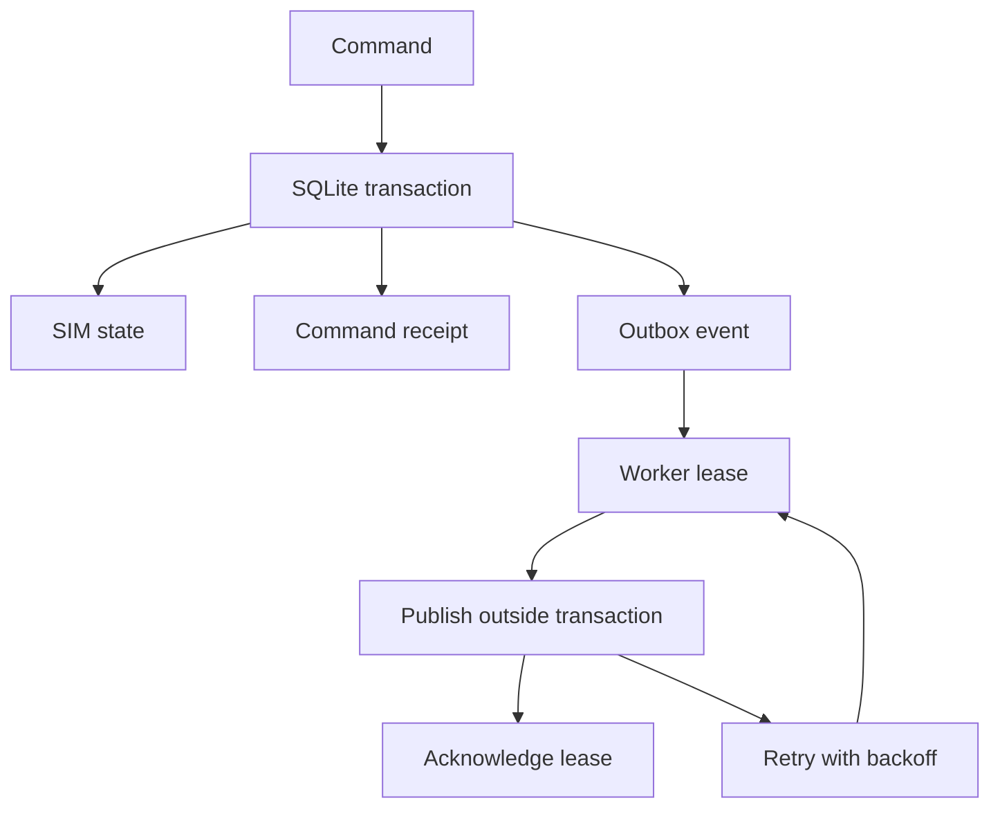

# Durable provisioning commands — Yousof

A runnable Node.js 24 extension to the existing SIM domain. It demonstrates what
happens between deciding to activate a SIM and delivering that request to a carrier.

## Try it

From the repository root, using Node.js 24:

```bash
npm ci
npm run test:ci
npm run demo:outbox
```

The demo creates `sim-demo.db`, requests an activation, retries the identical
command, and delivers the event to a console stub. Both command responses contain
the same event ID. Run it again: the receipt survives and no second event is sent.
Set `SIM_DB` to another path for an independent run. The carrier is a stub; the SIM
stays `ACTIVATING` until a separate confirmation command is applied.

## What to review

| File | Engineering decision |
|---|---|
| [store.mjs](store.mjs) | SQLite transaction combines SIM state, command receipt and outbox events |
| [relay.mjs](relay.mjs) | Publishes outside the transaction; acknowledges only the current lease |
| [outbox.test.mjs](outbox.test.mjs) | Real database failures, separate worker connections and restart recovery |



A `(tenant, commandId)` uniqueness constraint makes command retries durable.
Identical payloads return the original result; changed payloads conflict.
The existing domain state machine still owns transitions and guards.

The relay leases one event at a time. Expired leases can be reclaimed; a unique
lease token prevents an old worker from acknowledging a newer worker's claim.
A failed publish schedules a capped exponential delay rather than a tight retry.

Delivery is **at least once**. If the process crashes after publishing but before
acknowledging, the event is sent again with its original ID. A real carrier adapter
or consumer must deduplicate that ID; this example does not claim exactly-once
external side effects.

## Scope and trade-offs

- Uses Node's built-in `node:sqlite` and `node:test`; the modern example adds no runtime packages.
- SQLite synchronous transactions keep the example easy to inspect. They block the event loop and are intended for this local example, not a high-throughput service.
- Tenant values and approval context are trusted service inputs. Authentication, authorization and approver verification must happen before calling this library. It exposes no public HTTP endpoint.
- The sample relay has no lease heartbeat or carrier timeout. Failed publishes have a configurable attempt ceiling and durable quarantine; crashed or hung publishers still rely on lease expiry. Long sends can outlive their lease and be replayed.
- Events for one SIM are not guaranteed to complete in order across concurrent workers. A production relay needs per-SIM ordering or version-aware consumers.
- Receipts and sent events are retained indefinitely. Retention, schema migrations and operational monitoring are follow-up work.

The tests exercise failure semantics, not throughput. No production performance
numbers are claimed.

## Quarantine and replay

The relay defaults to five attempts before quarantining a failed event. See the root README's recovery section for the lease-fenced transition, tenant-scoped operator replay and crash/ambiguous-delivery limitations.
